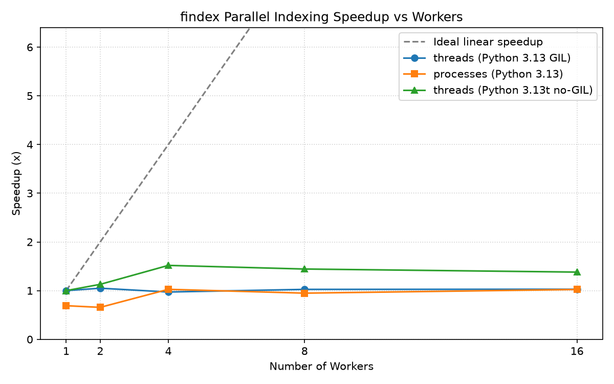

# findex

Локальний повнотекстовий пошуковий рушій на Python із підтримкою паралельної побудови індексу (`serial`, `threads`, `processes`), ранжування (BM25 / TF-IDF), мови булевих і фразових запитів та суворої статичної типізації.


## Встановлення

```bash
# Встановлення як CLI-утиліти
uv tool install .

# Встановлення для розробки
uv sync
```

## Використання CLI

```bash
# Паралельна побудова індексу (за замовчуванням --executor processes, усі логічні ядра)
findex index data --out index.bin

# Явний вибір виконавця та кількості воркерів
findex index data --out index.bin --executor processes --workers 4
findex index data --out index.bin --executor threads --workers 8
findex index data --out index.bin --executor serial

# Пошук із ранжуванням BM25 / TF-IDF
findex search index.bin "physical AND (settings OR network)" --scorer bm25
findex search index.bin '"physical settings"' --scorer tfidf --json

# Статистика індексу
findex stats index.bin
```

---

## Бенчмарк паралельної індексації (Lab 05)

### Апаратне забезпечення та методика вимірювання
- **Процесор:** AMD Ryzen 7 6800H (8 фізичних ядер / 16 логічних потоків, Zen 3+, базові 3.2 ГГц)
- **ОЗП та ОС:** 16 ГБ DDR5, Windows 11
- **Інтерпретатори:** CPython `3.13.18` (стандартна збірка з GIL, `sys._is_gil_enabled() == True`) та `3.13.18t` (free-threaded збірка без GIL, `sys._is_gil_enabled() == False`)
- **Методика:** перед кожною серією виконувався прогрів (warmup); кожна конфігурація `{executor, workers}` проганялася по 3 рази на повному корпусі (`data/`, 11 файлів різного обсягу), у таблицю занесено **медіанні значення** (`time.perf_counter()` для Wall time, `time.process_time()` для CPU time батьківського процесу, Win32 `PeakWorkingSetSize` для Peak RSS).

### Таблиця результатів

| Executor | Workers | Wall (s, median) | CPU (s) | Peak RSS (MB) | Merge (s) | Speedup |
|---|---:|---:|---:|---:|---:|---:|
| serial (`3.13`, GIL) | 1 | 1.3835 | 1.3906 | 205.4 | 0.0421 | 1.00x |
| threads (`3.13`, GIL) | 2 | 1.3184 | 1.3125 | 205.7 | 0.0682 | 1.05x |
| threads (`3.13`, GIL) | 4 | 1.4235 | 1.4219 | 231.2 | 0.0452 | 0.97x |
| threads (`3.13`, GIL) | 8 | 1.3490 | 1.3281 | 233.1 | 0.0455 | 1.03x |
| threads (`3.13`, GIL) | 16 | 1.3450 | 1.3438 | 236.1 | 0.0498 | 1.03x |
| processes (`3.13`, spawn) | 1 | 2.0042 | 0.3125 | 236.1 | 0.0435 | 0.69x |
| processes (`3.13`, spawn) | 2 | 2.1080 | 0.3438 | 236.1 | 0.0843 | 0.66x |
| processes (`3.13`, spawn) | 4 | 1.3478 | 0.3438 | 236.1 | 0.0508 | 1.03x |
| processes (`3.13`, spawn) | 8 | 1.4586 | 0.3594 | 236.1 | 0.0500 | 0.95x |
| processes (`3.13`, spawn) | 16 | 1.3517 | 0.4062 | 236.1 | 0.0568 | 1.02x |
| serial (`3.13t`, no-GIL) | 1 | 1.9807 | 1.9844 | 263.2 | 0.0991 | 1.00x |
| threads (`3.13t`, no-GIL) | 2 | 1.7542 | 1.7500 | 518.9 | 0.0737 | 1.13x |
| threads (`3.13t`, no-GIL) | 4 | 1.3047 | 1.8750 | 529.3 | 0.0775 | 1.52x |
| threads (`3.13t`, no-GIL) | 8 | 1.3721 | 1.7812 | 577.0 | 0.0785 | 1.44x |
| threads (`3.13t`, no-GIL) | 16 | 1.4347 | 2.2031 | 612.0 | 0.0992 | 1.38x |

### Графік прискорення від кількості воркерів



### Контр-дослід на I/O-bound задачі (читання файлів з диска)
Для перевірки різниці між CPU-bound та I/O-bound навантаженням проведено окремий тест багаторазового читання файлів корпусу з диска (`11 файлів × 20 проходів`):
- **Послідовно (`serial`):** `0.0777 s`
- **У потоках (`threads`, 8 воркерів):** `0.0503 s` (прискорення **`1.54x`**)

Під час системних викликів читання файлів потік відпускає GIL, дозволяючи іншим потокам перекривати очікування вводу-виводу.

---

## Чому результати саме такі: GIL, процеси, закон Амдала та Python 3.13t

### 1. Чому потоки під GIL не прискорили індексацію
Побудова інвертованого індексу — це переважно **CPU-bound** задача: регулярні вирази в `tokenize()`, приведення до нижнього регістру, створення кортежів позицій та оновлення словників `defaultdict`. У стандартному CPython 3.13 діє **Global Interpreter Lock (GIL)** — м'ютекс, який захищає внутрішні структури інтерпретатора (насамперед лічильники посилань `ob_refcnt`) і дозволяє виконувати байткод Python лише одному потоку в кожен момент часу. Кожні ~5 мс (`sys.getswitchinterval()`) потоки змагаються за захоплення GIL, через що на 2–16 потоках прискорення залишається в межах похибки (`0.97x–1.05x`), а CPU time дорівнює Wall time.

### 2. Чим оплачується паралелізм у процесах (`spawn`, `pickle`, CPU vs Wall, RSS)
`ProcessPoolExecutor` обходить GIL, запускаючи окремі процеси зі власним інтерпретатором і власною пам'яттю. Але на Windows використовується метод запуску **`spawn`**, а не `fork`:
- Кожен воркер стартує «з нуля» і заново імпортує модулі проєкту (`findex`), що створює стартові накладні витрати (на 1–2 воркерах Wall time становить `2.00–2.11 s` проти `1.38 s` у `serial`, і лише з 4 воркерів виходить у плюс — `1.3478 s`, `1.03x`).
- Дані між процесами передаються через серіалізацію **`pickle`**. Щоб не платити за пересилання сирих текстів туди-назад, у `build_partial` передаються лише шляхи до файлів та стартові діапазони `doc_id`, проте готові словники `PartialIndex` усе одно серіалізуються через pipe у батьківський процес.
- **CPU time проти Wall time:** `time.process_time()` батьківського процесу показує лише `0.31–0.41 s` (час на координацію пулу, десеріалізацію `pickle` та `merge`), тоді як реальна обчислювальна робота розподілена між дочірніми процесами.
- **Пам'ять (RSS):** батьківський процес займає `236.1 MB`, але кожен із $N$ воркерів виділяє власну пам'ять під свій шматок індексу до завершення `merge`.

### 3. Де в часі `merge` видно закон Амдала та дисбаланс чанків
Закон Амдала стверджує, що максимальне прискорення обмежене часткою роботи $s$, яка виконується послідовно:
$$S_{\max} = \frac{1}{s + \frac{1 - s}{N}}$$
У нашій архітектурі етап **`merge(partials)`** є повністю послідовним (`0.042–0.084 s`, або ~3–6% від часу `serial`). Проте на реальному корпусі `data/` (11 файлів) головним обмежувачем став **дисбаланс розмірів файлів**: найбільший файл корпусу обробляється одним воркером у `build_partial`, і жодна кількість додаткових ядер (8 чи 16) не може прискорити токенізацію одного неподільного файлу швидше, ніж час його обробки одним ядром. Саме тому крива прискорення виходить на плато вже на 4 воркерах.

### 4. Що змінилося на free-threaded Python `3.13t` (`sys._is_gil_enabled() == False`)
На збірці `3.13t` без GIL один потік працює повільніше через накладні витрати на потокобезпечний підрахунок посилань (`1.9807 s` проти `1.3835 s` у звичайному `3.13`), але при додаванні потоків **код на `ThreadPoolExecutor` реально масштабується на кількох ядрах**: на 4 потоках Wall time падає з `1.9807 s` до `1.3047 s` (прискорення **`1.52x`** відносно однопотокового `3.13t` і швидше за `serial` у звичайному `3.13`), а CPU time зростає до `1.88–2.20 s`, підтверджуючи одночасне виконання байткоду на кількох ядрах. Піковий RSS при цьому зростає до `518.9–612.0 MB` через окремі локальні алокатори пам'яті (mimalloc) для кожного потоку.

### 5. Викрита гонитва даних (Race Condition) без GIL та її виправлення
GIL захищає внутрішній стан інтерпретатора, але **не робить бізнес-логіку потокобезпечною**. Операція `counter += 1` у байткоді Python складається з окремих кроків читання (`LOAD_DEREF`), додавання (`BINARY_OP`) та запису (`STORE_DEREF`).
У тесті на 8 потоків по `200 000` інкрементів (очікуване значення **`1 600 000`**):
- **Зі звичайним GIL (`3.13`):** результат `1 600 000` (`0` втрачених оновлень — GIL випадково серіалізував виконання короткого циклу).
- **Без GIL (`3.13t`):** результат **`481 125`** — **втрачено `1 118 875` оновлень (~70%)** через одночасний перезапис змінної різними ядрами.
- **Виправлення:** використання `threading.Lock()` (`with lock: counter += 1`) відновлює інваріант (`1 600 000`), а в самому індексаторі `findex` спільний мутабельний стан між потоками повністю усунуто за рахунок ізольованих `PartialIndex` на кожен чанк і послідовного `merge` в одному потоці.

---

## Тестування та перевірка якості

```bash
uv run ruff check .
uv run ruff format --check .
uv run pyright
uv run pytest
```